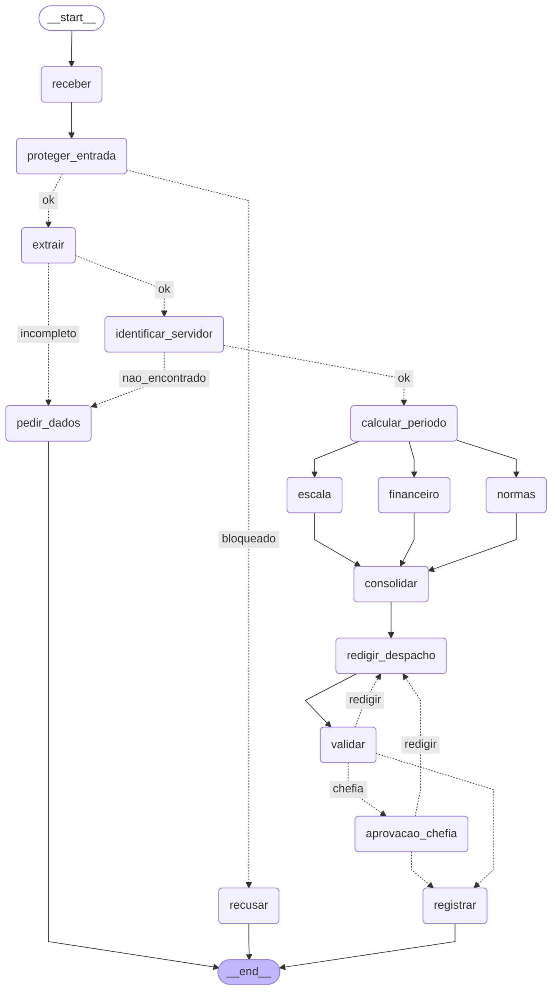

# Entrega: Assistente de Gestão de Pessoas

**Aluno(s):** Luiz Eduardo Paes Salomão
**Até onde chegou:** ( ) Marco mínimo (Etapa 6)  ( ) Marco completo (Etapa 9)  (x) Etapas 10–11
**Opcionais e bônus feitos:** ( ) 🆕 A  ( ) 🆕 B  ( ) 🆕 C  ( ) Outro: ______

## Etapa 0: quem verifica cada regra?

| Regra | Tema | Quem verifica (função Python / agente / humano) | Por quê | Onde foi implementada (preencha na Etapa 11) |
|---|---|---|---|---|
| N1 | férias | Função python | Verifica se o período é igual ou maior que 5 | etapa06_regras.py → violacoes_objetivas() (chamada no nó consolidar do grafo) |
| N2 | férias | Função python | É uma conta para verificada vendidos e saldo via IF | etapa06_regras.py → violacoes_objetivas(); valor da venda: agente Financeiro (etapa06_agentes.py → criar_financeiro()) |
| N3 | férias | Função python | É um requisito que uma função python consegue assegurar | etapa06_regras.py → violacoes_objetivas(), usando inicio_permitido() de etapa04_ferramentas.py |
| N4 | prazos | Função python | Basta ifs para analisar diferença de datas | etapa06_regras.py → violacoes_objetivas() |
| N5 | escala | Função python | Analisa o limite de 30% facilmente usando if | etapa06_regras.py → violacoes_objetivas() + tool consultar_escala do MCP (etapa05_mcp_rh.py) |
| N6 | abono | Função python | Basta usar if para checar dia útil e saldo de abonos | etapa06_regras.py → violacoes_objetivas() |
| N7 | diária | Função python | É um calculo | etapa06_agentes.py → criar_financeiro() (tools tabela_diarias e cotacao_dolar), nó financeiro do grafo |
| N8 | aprovação | Humano | Decisão de uma pessoa | etapa06_regras.py → precisa_chefia(); etapa07_grafo.py → aprovacao_chefia() (interrupt); etapa05_mcp_rh.py → registrar_decisao() (nega autoaprovação e chefia errada) |
| N9 | saúde | Guardrail + agente classificador | Buscar padrão do CID e perceber o assunto | etapa03_guardrails.py → encontrar_dado_sensivel() (regex CID) e classificador; etapa07_grafo.py → proteger_entrada() e rotear_extracao() (licença de saúde não segue) |
| N10 | dados | Função python | Dá para detector via função pois CPF e CID possuem formato fixo. | etapa07_grafo.py → problemas_do_despacho()/validar() e guardrail de saída em registrar(); instrução do Redator (criar_redator()) |

## Etapa 11: os 12 casos

Compare **caminho e estado**, não o texto do despacho. Execução partindo de `saidas/` vazia: `--todos`, depois
`--retomar C2_ferias_com_venda sim 1010` e `--retomar C11_diaria_exterior sim 1011` (modelo `gpt-6-luna`).

| Caso | Caminho percorrido | Resultado (bloqueado / pediu dados / triagem humana / indeferido / pausou na chefia / registrado + protocolo) | Bateu com o esperado? |
|---|---|---|---|
| C1_abono_simples | receber → proteger_entrada → extrair → identificar_servidor → calcular_periodo → (escala, financeiro, normas) → consolidar → redigir_despacho → validar → registrar | registrado (deferido, sem chefia) — ae788d33 | Sim |
| C2_ferias_com_venda | ... → validar → pausou em aprovacao_chefia → (sim 1010) → registrar | pausou na chefia → registrado — b7b6f485 | Sim |
| C3_dado_de_saude | receber → proteger_entrada → recusar | recusado (regex) | Sim |
| C4_fora_do_escopo | receber → proteger_entrada → recusar | recusado (fora do escopo) | Sim |
| C5_sem_matricula | receber → proteger_entrada → extrair → pedir_dados | pediu dados | Sim |
| C6_conflito_de_escala | ... → consolidar → redigir_despacho → validar → registrar | registrado (indeferido) — 6f1b47d7 | Sim |
| C7_autoaprovacao | receber → proteger_entrada → recusar | recusado (manipulação) | Sim |
| C8_idempotencia | receber → proteger_entrada → extrair → identificar_servidor → calcular_periodo → (escala, financeiro, normas) → consolidar → redigir_despacho → validar → registrar | duplicado — ae788d33 | Sim |
| C9_divergencia | receber → proteger_entrada → extrair → pedir_dados | pediu dados | Sim |
| C10_zona_cinzenta | receber → proteger_entrada → extrair → pedir_dados | pediu dados | Sim |
| C11_diaria_exterior | ... → validar → pausou em aprovacao_chefia → (sim 1011) → registrar | pausou na chefia → registrado — ec67dba1 | Sim |
| C12_inicio_proibido | ... → consolidar → redigir_despacho → validar → registrar | registrado (indeferido) — 7c458e62 | Sim |

**C9 e C10 (dependem do LLM):** Os dois foram para pedir_dados. No C9 ('uns dez dias perto da Páscoa') o extrator não
inventou datas (ficaram null). No C10 ('meu pai foi internado') o classificador deu nota 0,5 (abaixo do limiar 0,7),
então passou, mas o extrator classificou como 'outro' e sem datas, e o roteador pediu os dados.

## O grafo

## Etapa 4 (pronta): o que eu entendi

- Diferença entre a saída online e a offline: Offline: 3 tentativas falham ([retry]), os feriados vêm do arquivo local (1,5 s a mais, por causa das esperas 0,5 s + 1 s) e a cotação fica None ('a calcular'). As contas de datas e o protocolo são iguais. A API trouxe 14 feriados (inclui o Carnaval) e o arquivo, 13.
- Por que a espera do retry dobra a cada tentativa: dá tempo para o serviço se recuperar e evita bombardeá-lo com tentativas seguidas (que piorariam a sobrecarga).
- Por que o protocolo é um hash dos campos (e não um número sequencial): o mesmo pedido sempre gera o mesmo protocolo, então reenviá-lo (C8) não cria registro duplicado. Um número sequencial daria um protocolo novo a cada envio. E o hash não depende de um contador central.
- O que aconteceria sem o cache de feriados: A API seria chamada uma vez para cada dia consultado (dezenas de vezes por pedido): ficaria lento e poderíamos ser bloqueados por excesso de requisições.

## Observabilidade (C2)

- Onde o tempo foi gasto: Quase todo o tempo foi nos nós com LLM. normas (15,2 s, chamou consultar_normas 4 vezes), financeiro e escala (~7 s cada, em paralelo). identificar_servidor leva ~1-2 s sem LLM porque cada chamar_mcp sobe um processo novo do server MCP (stdio), faz o handshake e encerra.
- Tempo total: 44,92 s (soma dos nós) — nó mais lento: normas (15,24 s)
- Tokens totais: 8159

## Opcionais (preencha só os que fez)

- 🆕 A: não feito
- 🆕 B: não feito
- 🆕 C: não feito

## Reflexão (até 3 linhas cada)

1. Quem decide o caminho no seu sistema: o LLM, o grafo, as regras ou um humano? Dê um exemplo de cada.
   Os quatro, cada um numa parte: o LLM decide se o texto está no escopo (nota do classificador) e o que foi pedido (extração); o grafo decide a rota a partir do estado (sem matrícula → pedir_dados); as regras em Python decidem deferido/indeferido (C6 indeferido por N5); e o humano (chefia) aprova ou rejeita férias e diárias (C2).
2. Se o guardrail de entrada falhar, o que ainda impede uma autoaprovação?
   Três camadas: (1) as regras objetivas em Python decidem o deferimento, e o 'eu aprovo' do texto não muda nada (o C7 foi indeferido por N4); (2) a aprovação só vem do nó da chefia; (3) o server nega aprovador = próprio servidor ou chefia errada (DENY autoaprovação (N8)).
3. Por que o nó da chefia não pode gravar nada antes do `interrupt()`?
   Na retomada o nó roda de novo desde o começo (o print no começo de aprovacao_chefia apareceu 4 vezes no C2); por isso nada com efeito colateral (gravar, notificar) pode vir antes do interrupt().
4. Qual dado veio do **MCP**, qual de **API externa** e qual de **tool local**? Por que essa divisão?
   MCP: cadastro, escala, normas, tabela de diárias, salário e a gravação, ou seja, os dados internos do RH, atrás de um único ponto controlado (token, N8, auditoria). API externa: feriados (BrasilAPI) e câmbio (Frankfurter), dados públicos com retry e plano B. Tool local: cotacao_dolar, que só embrulha a API e não precisa de controle de acesso.
5. O que você mudaria para colocar este sistema em produção?
   Manter o server MCP sempre no ar (HTTP com autenticação) em vez de subir um processo por chamada; trocar JSON/SQLite por banco de dados; guardar o token num cofre de segredos; dar ao agente Normas as regras já filtradas para cortar tokens; e expor a aprovação da chefia por API/tela, com alertas sobre as métricas.

## De onde veio cada parte

Implementação feita com o apoio de um assistente de IA (Claude Code), seguindo o PASSO_A_PASSO.md e os exemplos das aulas
indicados em cada arquivo.

| Arquivo / trecho | Exemplo das aulas em que me baseei | O que precisei adaptar |
|---|---|---|
| etapa01_agente.py | aula1/segundo_agente.py, exercicios_resolvidos/aula4/ex10_function_tool.py | docstring dizendo quando usar e quando NÃO usar a tool |
| etapa02_extracao.py | aula2/agente_output2.py | descriptions que proíbem inventar datas e calculam o fim a partir de início + duração |
| etapa03_guardrails.py | aula2/agente_guardrail.py, exercicios_resolvidos/aula4/ex11_guardrails.py | guardrails em sequência (run_in_parallel=False): a regex barra antes de o texto chegar ao LLM |
| etapa05_mcp_rh.py | aula6/desafio2/mcp_unidades.py, aula5/exemplos/10_seguranca/server_seguro.py | idempotência por protocolo, N8 (chefia do cadastro) e auditoria em JSON Lines |
| etapa06_agentes.py / etapa06_linear.py | aula4/ex03_agente_as_tool.py, aula6/exemplos/01_fluxo_linear/main.py | temperature=0 só em modelos que aceitam (gpt-6-luna é de raciocínio); Financeiro conta diárias pelas datas do pedido |
| etapa07_grafo.py | aula6/desafio2/main.py, aula7/exemplos/08_paralelismo, aula7/exemplos/07_aprovacao_revisao | especialistas como nós em paralelo; Financeiro/Escala sem LLM quando não se aplicam; chefia com interrupt e no máx. 2 rejeições |
| etapa10_governanca.py / etapa10_observabilidade.py | aula3/agente_hook2.py, aula5/exemplos/11_observabilidade | tokens por nó (reducer no estado, porque os 3 especialistas escrevem no mesmo passo) |
